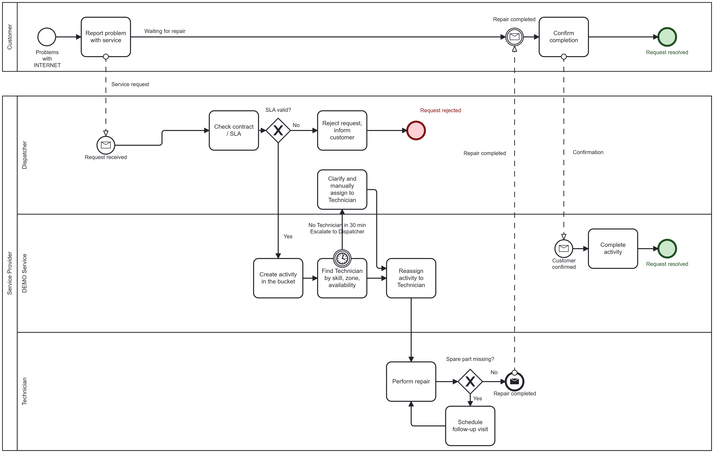
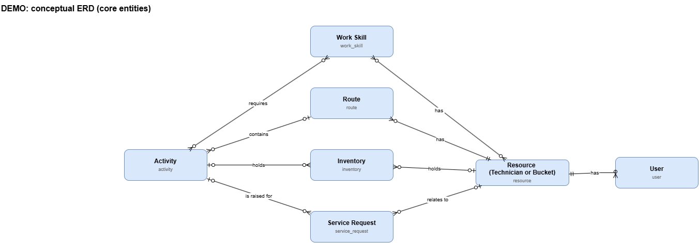
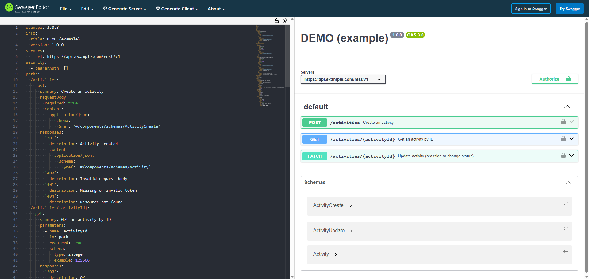

# Customer Outage Request (Illustrative Case Study)

An end-to-end system analysis of a common field service scenario, modeled as a business process, a data model and an API contract. All names and data are illustrative; no real company data is used.

**Author:** Oleksiy Milner · [LinkedIn](https://www.linkedin.com/in/oleksiy-milner-240a3969/)

## Scenario

A customer reports an internet outage. The provider verifies the contract and SLA, creates work in a team queue (bucket), finds a technician by skill, zone and availability, and reassigns the work. The technician completes the repair, or schedules a follow-up visit if a spare part is missing. The customer confirms, and the activity is completed.

**Actors:** Customer, Dispatcher, Technician, DEMO Service (system)

## Deliverables

| Artifact | What it shows | Tool | Files |
|---|---|---|---|
| BPMN process | Roles, SLA decision, escalation, customer confirmation | Camunda Modeler | [`bpmn/`](bpmn/) |
| Conceptual ERD | Core entities and relationships | draw.io | [`erd/`](erd/) |
| OpenAPI 3.0 spec | Create and update activities, JWT security | Swagger Editor | [`openapi/`](openapi/) |
| Requirements document | Requirements document (user stories, acceptance criteria, traceability)| .md | [`requirements/`](https://github.com/oleksiymilner/Customer-Outage-Request-Illustrative-Case-Study/blob/main/requirements/requirements.md) |

### Business process (BPMN)



### Data model (ERD)



### API contract (OpenAPI)



Endpoints: `POST /activities`, `GET /activities/{activityId}`, `PATCH /activities/{activityId}`.

## Key design decisions

- **SLA check:** an exclusive gateway with a separate reject path that informs the customer.
- **Escalation:** a 30-minute timer boundary event routes unmatched work to the dispatcher for manual assignment, instead of rejecting a valid request.
- **Follow-up loop:** a missing spare part triggers a follow-up visit, then returns to the repair step.
- **Bucket, then reassign:** work is created in a team queue and reassigned to a qualified technician. The API returns `422` if the technician lacks the required work skill.
- **Data model:** a resource can be a technician or a bucket; routes are created automatically; activity-skill and resource-skill are many-to-many relationships.
- **API contract:** JWT bearer security, standard `400`/`401`/`404` responses, `readOnly` server-generated fields, and a separate update schema for `PATCH`.

## Traceability

| BPMN step | API | Data entity |
|---|---|---|
| Check contract / SLA | internal business rule (out of API scope) | Service Request |
| Create activity in the bucket | `POST /activities` | Activity, Resource |
| Find technician by skill, zone, availability | internal matching (out of API scope) | Resource, Work Skill |
| Clarify and manually assign / Reassign activity | `PATCH /activities/{id}` (`resourceId`; `422` on skill mismatch) | Activity, Resource, Work Skill |
| Perform repair / follow-up visit | `PATCH /activities/{id}` (`status`) | Activity |
| Complete activity | `PATCH /activities/{id}` (`status: completed`) | Activity |

## Assumptions and scope

- The SLA check and technician matching are internal business rules and are not modeled in the API demo.
- After escalation, the dispatcher resolves the request manually, outside this model.
- `resourceId` on activity creation is the target bucket or technician; the route is created automatically.

## Repository structure

```
.
├── README.md
├── bpmn/
│   ├── customer-outage-request.bpmn
│   └── customer-outage-request.png
├── erd/
│   ├── conceptual-erd.drawio
│   └── conceptual-erd.png
└── openapi/
    ├── openapi.yml
    └── swagger-editor.png
├── requirements/
│   ├── requirements.md

```

## How to view the files

- **BPMN:** open the `.bpmn` file in [Camunda Modeler](https://camunda.com/download/modeler/) or at [bpmn.io](https://demo.bpmn.io/).
- **ERD:** open the `.drawio` file at [app.diagrams.net](https://app.diagrams.net/).
- **OpenAPI:** paste `openapi.yml` into [Swagger Editor](https://editor.swagger.io/).
